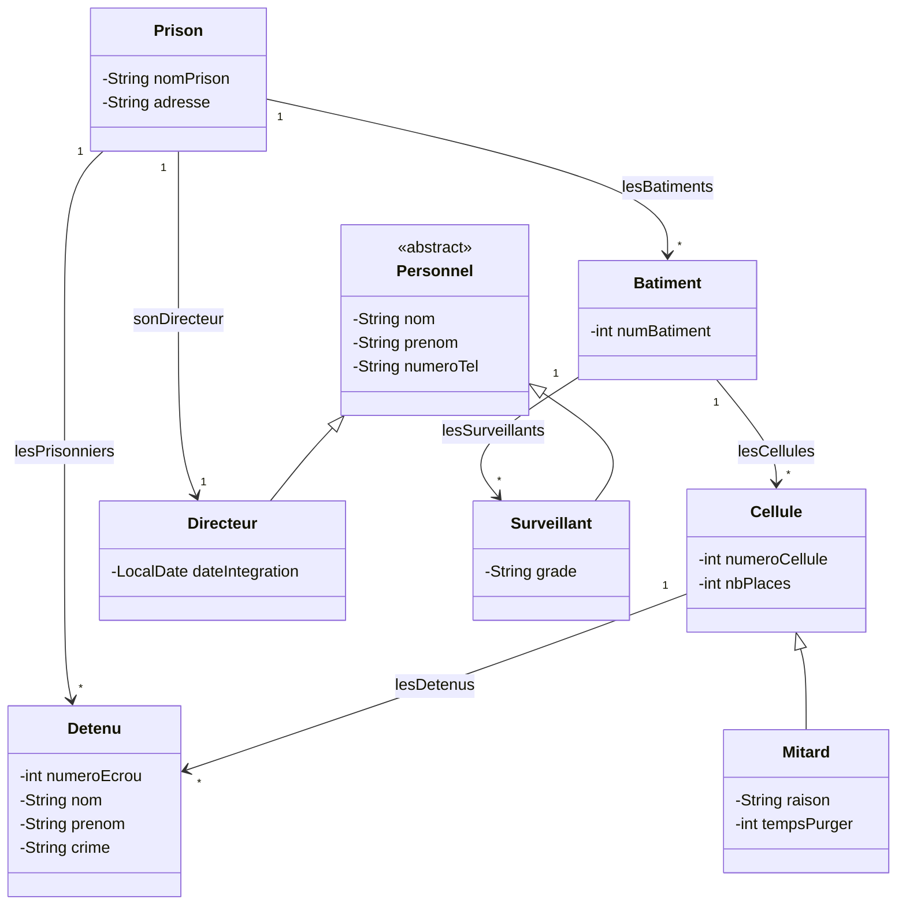

# HebSIO — Application de gestion d'un établissement pénitentiaire

Application de bureau Java (Swing) qui permet de gérer une prison fictive : cellules, mitards, détenus, surveillants et directeur, avec une base MySQL et des exports CSV, XML et JSON.

> Projet réalisé pendant le BTS SIO option SLAM. Les données sont fictives.


## Contexte et objectif

L'objectif était de concevoir une application de gestion complète en programmation orientée objet : modéliser un domaine métier avec de l'héritage, séparer l'interface, la logique et l'accès aux données (MVC), persister les données dans MySQL et tester les classes métier.

## Fonctionnalités réalisées

| Domaine | Fonctionnalités |
| --- | --- |
| Tableau de bord | Nombre de cellules, de détenus et de surveillants |
| Cellules | Ajout de cellules standard et de mitards (raison, durée), liste, export |
| Détenus | Incarcération (numéro d'écrou, crime, cellule), registre, recherche, suppression, export |
| Personnel | Ajout, liste, recherche et suppression de surveillants ; consultation et modification du directeur |
| Exports | Formats texte, CSV, XML et JSON depuis les classes métier |

## Architecture

Le projet suit le modèle **MVC** :

- **Modèle métier** : `Prison`, `Batiment`, `Cellule`, `Mitard`, `Detenu`, `Personnel`, `Directeur`, `Surveillant`
- **Accès aux données** : `Modele` (JDBC, requêtes préparées)
- **Contrôleur** : `Controleur` (navigation entre les écrans)
- **Vues** : `VuePrincipale` et les panneaux `Panel*` (Swing)



## Structure

```text
src/    code source (modèle, vues Swing, contrôleur, accès MySQL)
test/   tests JUnit 5 des classes métier et du modèle
config.example.properties   modèle de configuration de la base
```

## Prérequis

- JDK 8 ou supérieur
- MySQL avec une base `HebSIO`
- Connecteur JDBC `mysql-connector-java` 8.x
- JUnit 5 pour les tests

## Installation et démarrage

1. Cloner le dépôt.
2. Copier `config.example.properties` en `config.properties` et renseigner l'URL, l'utilisateur et le mot de passe de la base (ou définir `HEBSIO_DB_URL`, `HEBSIO_DB_USER`, `HEBSIO_DB_PASSWORD`).
3. Ajouter le connecteur MySQL au classpath (le fichier `.classpath` d'Eclipse pointe vers un chemin local à adapter).
4. Compiler et lancer :

```bash
javac -encoding UTF-8 -d out src/*.java
java -cp "out:mysql-connector-java-8.0.21.jar" Programme
```

## Tests

Le dossier `test/` contient 29 tests JUnit 5 répartis sur 8 classes (`Batiment`, `Cellule`, `Detenu`, `Directeur`, `Mitard`, `Prison`, `Surveillant`, `Modele`). Les tests de `ModeleTest` nécessitent une base MySQL locale.

## Limites connues

- Le script SQL de création de la base n'est pas encore versionné.
- Pas d'outil de build (Maven/Gradle) : les dépendances sont configurées dans Eclipse.
- Les tests d'accès aux données dépendent d'une base réelle.

## Améliorations prévues

- Ajouter le script SQL (schéma et jeu de données fictif).
- Passer à Maven pour gérer les dépendances et lancer les tests.
- Ajouter une intégration continue GitHub Actions pour compiler et exécuter les tests métier.

## Auteur

**Marouane AMEJJOUD** — L3 MIAGE, Université Paris-Saclay
[LinkedIn](https://www.linkedin.com/in/marouaneamejjoud/) · [GitHub](https://github.com/Marouane55z)
